# Zero Trust Hybrid University Network — Security Assessment & Remediation Lab

> **Academic project — Jazan University, CNET-463 Network Security Management (Case Study 2, Team T01).**
> The lab environment (Docker kit, network topology and deliberately planted weaknesses) was designed and built by **Dr. Mohammed Jubur**. This repository documents our assessment, fixes and evidence only; the lab kit itself is not redistributed here.
> The full submitted report is available at `docs/Report_Case_Study_T01.pdf`.
 
<p align="center">
  
  
  
  
  
</p>

---

##  Team Members & Contribution Matrix

| Member Name | Assigned Part | Functional Responsibility |
| :--- | :---: | :--- |
| **Abdulaziz Mashnawi** | **Part A & B** | Network Discovery, Vulnerability Assessment, Host Micro-segmentation & nftables Remediation |
| **Abdullah Abdali** | **Part C** | Policy Enforcement Point (PEP) Policy Audit, Device Posture & Path Security Hardening |
| **Abdulaziz Difallah Asiri** | **Part D & E** | WireGuard Vendor Tunnel Scoping, VPN vs. ZTNA Evaluation, PKI & X.509 Certificate Remediation |
| **Khalid Alfaifi** | **Part F** | Cloud/Hybrid Controls, Egress Restrictions, and Cloud Shared Responsibility Framework |
| **Khalid Al-Qanbar** | **Part G** | CISA ZTMM v2.0 Maturity Assessment, Gap Analysis & Executive Management Memo |

---

## Key Results at a Glance

| # | Weakness found | Fix applied | Verified with |
| :-: | :--- | :--- | :--- |
| 1 | Student, staff and guest could reach the exam database (`1521/tcp`) | Removed `10.145.10.0/24` allow rule in `server-db.nft` | nmap before/after, tcpdump |
| 2 | Guest allow-all rule on database, records and exam-app hosts | Removed `ip saddr 10.145.10.13 accept` from 3 firewalls | nmap (closed → filtered) |
| 3 | Vendor WireGuard tunnel routed the whole `10.145.0.0/16` | `AllowedIPs = 10.145.40.20/32` | nmap, ssh from vendor host |
| 4 | Vendor trusted by database and admin host firewalls | Removed both vendor allow rules | `nft list ruleset`, nmap |
| 5 | PEP ignored device posture (unmanaged device allowed) | `REQUIRE_DEVICE_POSTURE = True` | curl: 200 → 403 |
| 6 | PEP exposed `/admin` and `/metrics` to students | `EXPOSE_ADMIN_PATHS = False` | curl: 200 → 404 |
| 7 | Expired certificate with wrong name (CN/SAN) | Fixed `pki/make_certs.sh` (name + `-days 365`) | openssl, curl: exit 60 → exit 0 |
| + | Extra: case-sensitive (`/ADMIN`) and URL-encoded (`/%61dmin`) path-filter bypasses | Normalised path (decode + lower-case) before the policy check | curl: 200 → 404 |

---

##  Table of Contents

1. [Executive Summary & Lab Architecture](#1-executive-summary--lab-architecture)
2. [Network Parameters & IP Schema](#2-network-parameters--ip-schema)
3. [Lab Directory Structure](#3-lab-directory-structure)
4. [Part A: Network Discovery & Threat Surface Assessment](#4-part-a-network-discovery--threat-surface-assessment)
5. [Part B: Host-Level Micro-Segmentation Remediation](#5-part-b-host-level-micro-segmentation-remediation)
6. [Part C: Policy Enforcement Point (PEP) Hardening](#6-part-c-policy-enforcement-point-pep-hardening)
7. [Part D: Secure Remote Connectivity & WireGuard Scoping](#7-part-d-secure-remote-connectivity--wireguard-scoping)
8. [Part E: TLS, Public Key Infrastructure (PKI) & Trust Lifecycle](#8-part-e-tls-public-key-infrastructure-pki--trust-lifecycle)
9. [Part F: Cloud/Hybrid Controls & Shared Responsibility Framework](#9-part-f-cloudhybrid-controls--shared-responsibility-framework)
10. [Part G: CISA ZTMM v2.0 Maturity Rating & Management Memo](#10-part-g-cisa-ztmm-v20-maturity-rating--management-memo)
11. [Quickstart: Deploying & Validating the Lab](#11-quickstart-deploying--validating-the-lab)
12. [Academic References](#12-academic-references)

---

## 1. Executive Summary & Lab Architecture

This repository delivers an end-to-end security audit, exploit proof-of-concept, and Zero Trust remediation for the **Jazan University Online Examination System**. 

The system operates across a **hybrid topology**:
- **Cloud Workload:** An examination web application (`examapp`) deployed in a cloud-hosted container environment.
- **On-Premises Infrastructure:** Highly confidential student academic records (`server-records`) and examination test banks (`server-db`) hosted in the on-premises university data center.
- **Edge Access Control:** A reverse-proxy Policy Enforcement Point (`pep`) interfacing with an Identity Provider (`idp`).
- **Remote Vendor Maintenance:** An external vendor connecting via a WireGuard cryptokey-routed tunnel to perform maintenance on designated campus support systems.

### Discovered Deficiencies Prior to Remediation
Prior to our security engineering intervention, the campus network operated under legacy perimeter-security assumptions:
1. **Flat L2 Trust Model:** All 11 containers operated on a single Docker bridge network where internal zone boundaries were poorly isolated.
2. **Database Overexposure:** The central Oracle database (`1521/tcp`) was directly accessible to student, staff, and guest subnets.
3. **Guest Network Backdoors:** The guest host possessed unconditional allow-all rules across core servers.
4. **Excessive Vendor VPN Scope:** The vendor WireGuard tunnel allowed the full `/16` campus subnet (`65,536` addresses) and permitted SSH into the primary administrative jump box.
5. **PEP Policy Vulnerabilities:** The PEP bypassed device posture checks (`REQUIRE_DEVICE_POSTURE = False`), exposed privileged administrative endpoints (`/admin`, `/metrics`), and suffered from case-sensitivity and URL-encoding bypasses.
6. **Broken PKI & TLS:** The PEP presented an expired X.509 certificate with a Common Name mismatch (`staff.engineering...` instead of `exam.engineering...`), rendering TLS unverified and forcing users toward unsafe bypasses.

<p align="center">
  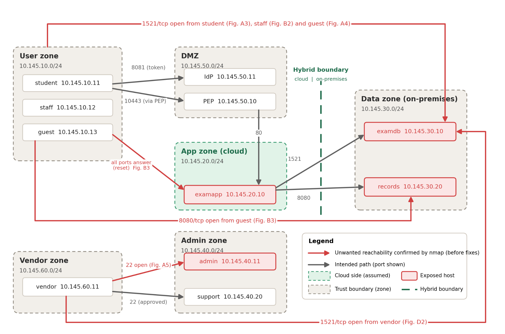
  <br>
  <em>Figure A6: Current-State Network Diagram of Team T01 (Observed via Active Scanning). Red vectors represent unwanted lateral reachability.</em>
</p>

---

## 2. Network Parameters & IP Schema

The isolated lab environment is allocated the dedicated class B CIDR block `10.145.0.0/16`.

| Network Zone | Subnet | Host / Service | IP Address | Ingress / Egress Ports | Security Function |
| :--- | :--- | :--- | :--- | :--- | :--- |
| **User Zone** | `10.145.10.0/24` | `student` | `10.145.10.11` | Dynamic | Untrusted student testing workstation |
| | | `staff` | `10.145.10.12` | Dynamic | University staff endpoint |
| | | `guest` | `10.145.10.13` | Dynamic | Untrusted guest visitor endpoint |
| **App Zone (Cloud)** | `10.145.20.0/24` | `examapp` | `10.145.20.10` | `80/tcp` (HTTP) | Core examination logic engine |
| **Data Zone (On-Prem)**| `10.145.30.0/24` | `server-db` | `10.145.30.10` | `1521/tcp` (SQL/Oracle) | Central confidential database |
| | | `server-records` | `10.145.30.20` | `8080/tcp` (REST API) | Student records backend service |
| **Admin Zone** | `10.145.40.0/24` | `admin` | `10.145.40.11` | `22/tcp` (SSH) | Privileged administrative jump box |
| | | `server-support`| `10.145.40.20` | `22/tcp` (SSH) | Designated vendor maintenance host |
| **DMZ** | `10.145.50.0/24` | `pep` | `10.145.50.10` | `10443/tcp` (HTTPS) | Policy Enforcement Point Gateway |
| | | `idp` | `10.145.50.11` | `8081/tcp` (HTTP) | HMAC-based Token Authentication Service |
| **Vendor Zone** | `10.145.60.0/24` | `vendor` | `10.145.60.11` | WireGuard client (peer endpoint `10.145.40.20:51820`) | External vendor technician endpoint |

**Core Service Fully Qualified Domain Names (FQDN):**
- **Exam Gateway:** `https://exam.engineering.t01.uni.lab:10443`
- **Identity Provider (IdP):** `http://10.145.50.11:8081/token`
- **Records Service:** `http://records.engineering.t01.uni.lab:8080`
- **Internal PKI Authority:** `Coastal Campus Internal CA (T01)`

---

## 3. Lab Directory Structure

```text
zero-trust-hybrid-network-lab/
├── README.md                          # Comprehensive Zero Trust engineering documentation
├── docker-compose.yml                 # Container orchestration and bridge network definition
├── TEAM_INFO.txt                      # Assignment specifications & network allocations
├── docs/
│   └── images/                        # High-resolution test captures, diffs, and network diagrams
├── edge/
│   └── pep.py                         # Reverse proxy PEP with token verification & path filters
├── examapp/
│   ├── app.py                         # Application business logic
│   └── listener.py                    # Internal IPC listener service
├── firewall/
│   ├── admin.nft                      # Admin jump host nftables ruleset
│   ├── examapp.nft                    # Cloud exam application host firewall
│   ├── server-db.nft                  # Database backend host firewall
│   ├── server-records.nft             # Academic records backend host firewall
│   └── server-support.nft             # Support host firewall
├── idp/
│   └── app.py                         # Lightweight HMAC-SHA256 token dispenser
├── pki/
│   ├── make_certs.sh                  # OpenSSL CA and X.509 certificate generation pipeline
│   └── out/                           # CA root, server keys, CSRs, and active certificates
├── tools/
│   ├── Dockerfile                     # Base alpine image with nmap, curl, tcpdump, nftables
│   └── entrypoint.sh                  # Host initialization and nftables rule auto-loader
└── vendor/
    └── wg0.conf                       # WireGuard VPN client configuration profile
```

> The tree above shows the layout of the course lab kit for reference. Files under `pki/out/` (CA and service private keys) must never be committed; see `.gitignore`.

---

## 4. Part A: Network Discovery & Threat Surface Assessment
**Assigned to:** Abdulaziz Mashnawi

### Methodology & Reconnaissance
Reconnaissance was executed strictly from the student container (`student`, `10.145.10.11`) targeting the team's isolated network (`10.145.0.0/16`). No external networks were probed.

```bash
# Verify student host identity and IP binding
docker compose exec student ip addr
```
<p align="center">
  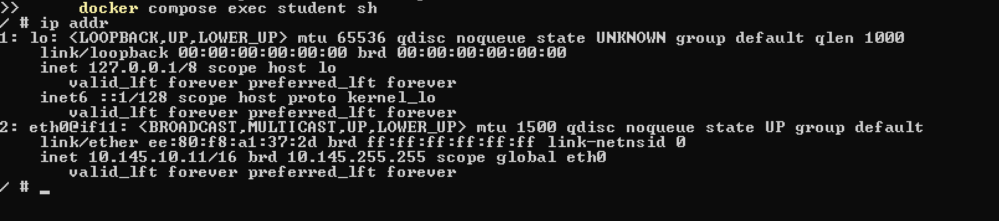
  <br>
  <em>Figure A1: Verification of IP address (10.145.10.11) on student host.</em>
</p>

```bash
# Network-wide host discovery scan
docker compose exec student nmap -sn 10.145.0.0/16
```
<p align="center">
  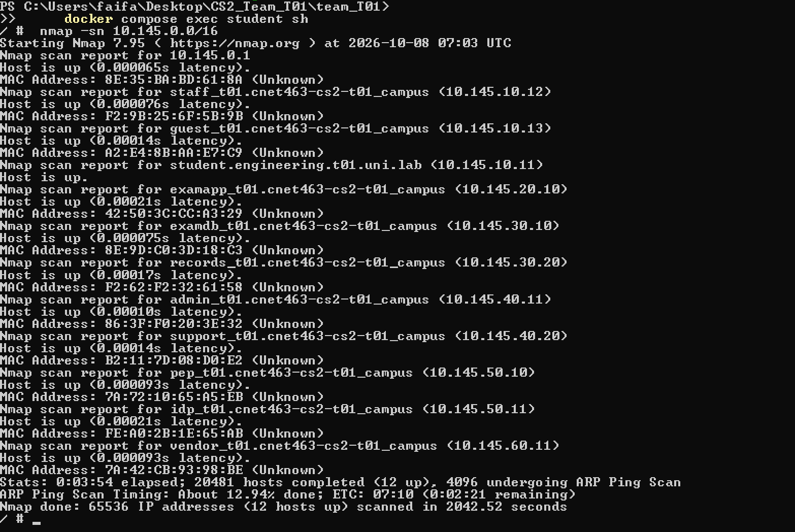
  <br>
  <em>Figure A2: ARP Ping scan revealing 12 active IP targets on the 10.145.0.0/16 campus subnet.</em>
</p>

### Port Scanning Results & Security Findings
Comprehensive port scanning (`nmap -Pn -p-`) conducted across the segmented boundaries revealed alarming policy violations:

| Source Host | Target Host & IP | Probe Results | Expected Policy | Verdict | Evidence |
| :--- | :--- | :--- | :--- | :---: | :--- |
| `student` (`.10.11`) | `server-db` (`.30.10`) | `1521/tcp open`, 65534 filtered | **Blocked** | ❌ **Weakness** | [Figure A3](docs/images/fig_a3_student_to_examdb_open.png) |
| `guest` (`.10.13`) | `server-db` (`.30.10`) | `1521/tcp open`, 65534 closed (RST) | **Blocked** | ❌ **Weakness** | [Figure A4](docs/images/fig_a4_guest_to_examdb_open.png) |
| `vendor` (`.60.11`) | `admin` (`.40.11`) | `22/tcp open` (SSH) | **Blocked** | ❌ **Weakness** | [Figure A5](docs/images/fig_a5_vendor_to_admin_ssh_open.png) |
| `student` (`.10.11`) | `admin` (`.40.11`) | All 65535 ports filtered | **Blocked** |  **Enforced** | [Figure A7](docs/images/fig_a7_student_to_admin_filtered.png) |
| `student` (`.10.11`) | `examapp`, `support`, `records` | All 65535 ports filtered | **Blocked** |  **Enforced** | [Figure A8](docs/images/fig_a8_student_nmap_other_zones.png) |
| `student` (`.10.11`) | `pep` (`.50.10`) | `10443/tcp open` | **Allowed (Entry Point)** |  **Enforced** | [Figure A8](docs/images/fig_a8_student_nmap_other_zones.png) |
| `student` (`.10.11`) | `idp` (`.50.11`) | `8081/tcp open` | **Allowed (Auth Point)** |  **Enforced** | [Figure A8](docs/images/fig_a8_student_nmap_other_zones.png) |

<table align="center">
  <tr>
    <td align="center"><b>Student to Database (Exposed 1521/tcp)</b></td>
    <td align="center"><b>Guest to Database (Exposed 1521/tcp)</b></td>
  </tr>
  <tr>
    <td>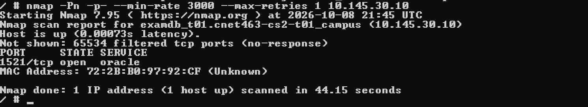</td>
    <td>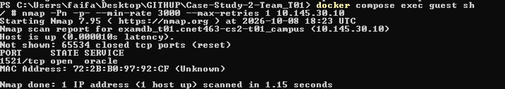</td>
  </tr>
  <tr>
    <td align="center"><em>Figure A3: Direct database access from student.</em></td>
    <td align="center"><em>Figure A4: Direct database access from guest.</em></td>
  </tr>
</table>

<table align="center">
  <tr>
    <td align="center"><b>Vendor to Admin Jump Box (Exposed 22/tcp)</b></td>
    <td align="center"><b>Student to Admin Jump Box (Filtered)</b></td>
  </tr>
  <tr>
    <td>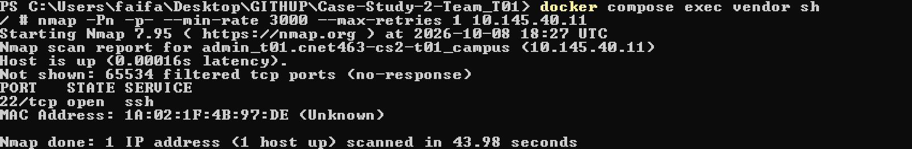</td>
    <td>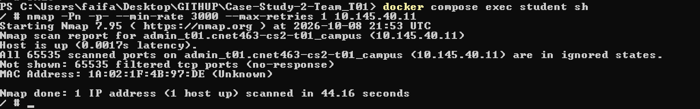</td>
  </tr>
  <tr>
    <td align="center"><em>Figure A5: Unauthorized SSH reachability from vendor.</em></td>
    <td align="center"><em>Figure A7: Blocked access from student workstation.</em></td>
  </tr>
</table>

### Threat Analysis & Lateral Movement Paths
1. **Path 1 (Student/Guest to Examination Database):** An adversary compromising any unmanaged student laptop or connecting to guest Wi-Fi could establish direct SQL connections to `10.145.30.10:1521`, bypassing authentication, PEP authorization, and logging.
2. **Path 2 (Vendor to Administrative Jump Box):** A compromised vendor endpoint (`10.145.60.11`) could directly access port 22 on `10.145.40.11`. Establishing an SSH foothold on the jump box exposes the entire administrative tier, maximizing blast radius.

---

## 5. Part B: Host-Level Micro-Segmentation Remediation
**Assigned to:** Abdulaziz Mashnawi

### Pre-Remediation Baseline Scans
We executed standardized multi-host scans across ports `22, 1521, 8080`:

```bash
docker compose exec student sh -c 'nmap -Pn -p 22,1521,8080 10.145.20.10 10.145.30.10 10.145.30.20 10.145.40.11 10.145.40.20'
docker compose exec staff sh -c 'nmap -Pn -p 22,1521,8080 10.145.20.10 10.145.30.10 10.145.30.20 10.145.40.11 10.145.40.20'
docker compose exec guest sh -c 'nmap -Pn -p 22,1521,8080 10.145.20.10 10.145.30.10 10.145.30.20 10.145.40.11 10.145.40.20'
```

<p align="center">
  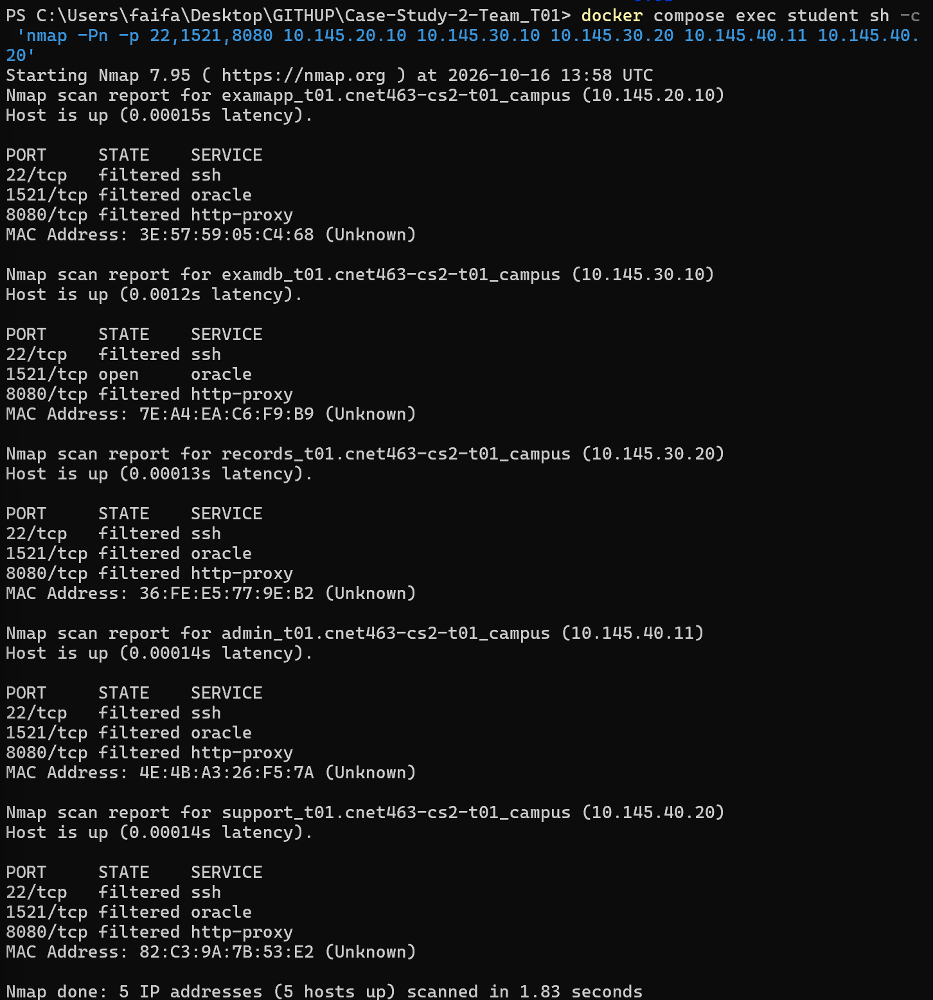
  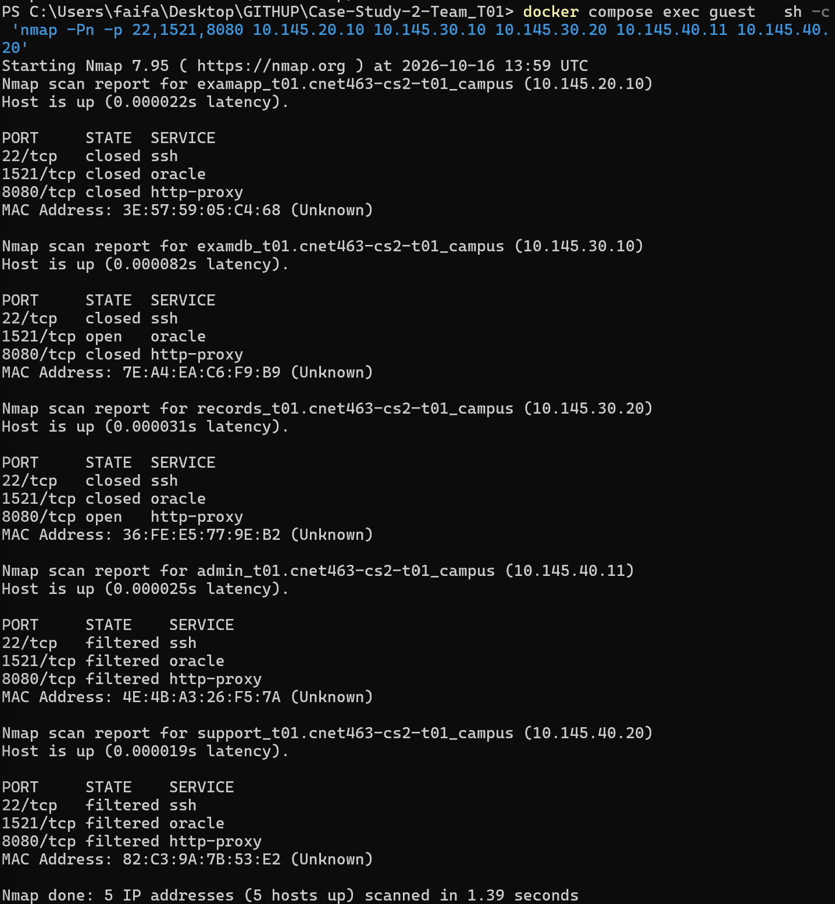
  <br>
  <em>Figures B1 & B3: Pre-fix scans. Student accesses 1521/tcp directly. Guest accesses 1521 on DB and 8080 on records, receiving "closed" (RST) on unmapped ports instead of "filtered".</em>
</p>

### Root Cause Analysis in Host Firewall Configurations
Inspection of `firewall/server-db.nft`, `firewall/server-records.nft`, and `firewall/examapp.nft` uncovered two distinct structural vulnerabilities:

<p align="center">
  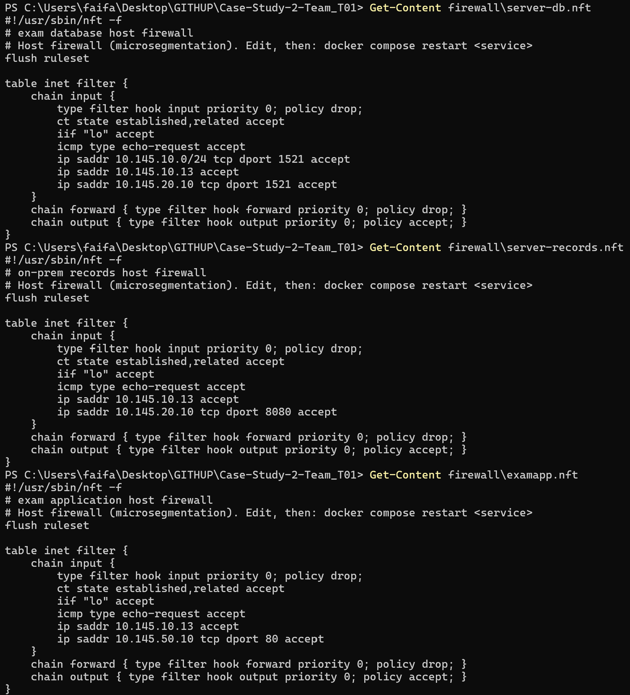
  <br>
  <em>Figure B4: Active nftables configuration prior to remediation.</em>
</p>

- **Flaw B.1 (Over-permissive User Subnet Trust):** `server-db.nft` explicitly permitted `ip saddr 10.145.10.0/24 tcp dport 1521 accept`, granting database access to students, staff, and guests alike.
- **Flaw B.2 (Unrestricted Guest IP Allow-All):** The directive `ip saddr 10.145.10.13 accept` was present without port constraints in `server-db.nft`, `server-records.nft`, and `examapp.nft`. This caused packets to hit host service sockets directly, eliciting TCP RSTs.

### Applied Configuration Changes
Adhering to NIST SP 800-41 and Zero Trust micro-segmentation principles, all extraneous allow rules were purged, preserving exclusively authorized east-west application traffic:

<p align="center">
  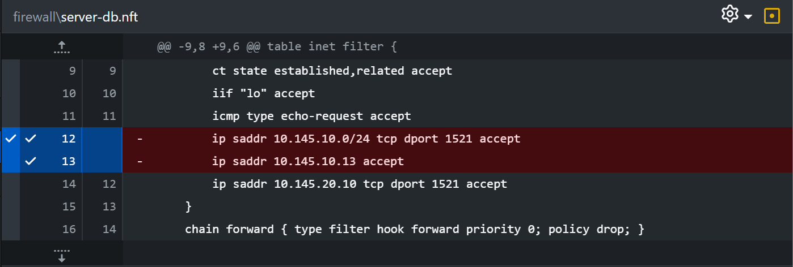<br>
  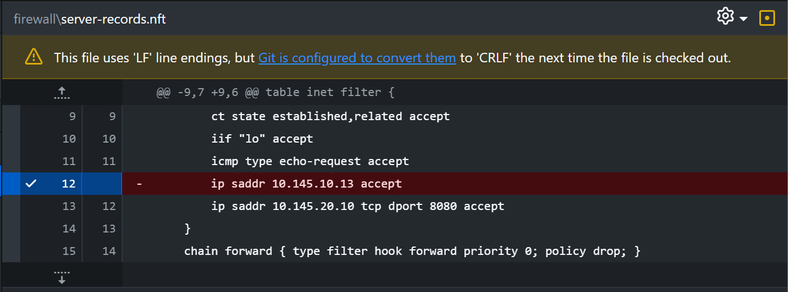<br>
  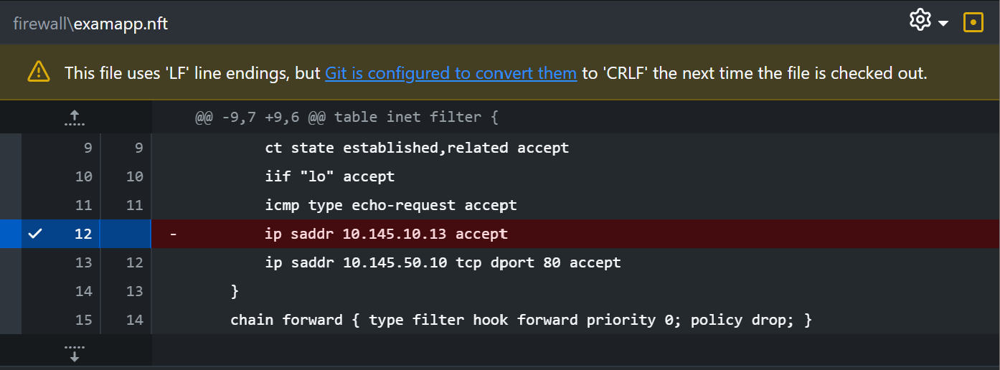
  <br>
  <em>Figure B5: Configuration diffs for server-db.nft, server-records.nft, and examapp.nft.</em>
</p>

```bash
# Reload host firewalls by restarting containers
docker compose restart examdb records examapp
```

<p align="center">
  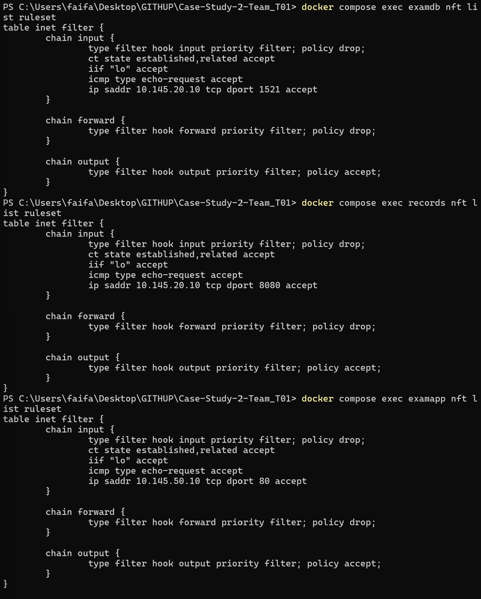
  <br>
  <em>Figure B6: Active nftables rulesets verifying strict default-drop and single-flow policies.</em>
</p>

### Post-Remediation Verification & Packet-Level Proof
Following remediation, scans from `student`, `staff`, and `guest` confirmed that all 15 targeted host/port combinations evaluated to `filtered`:

<p align="center">
  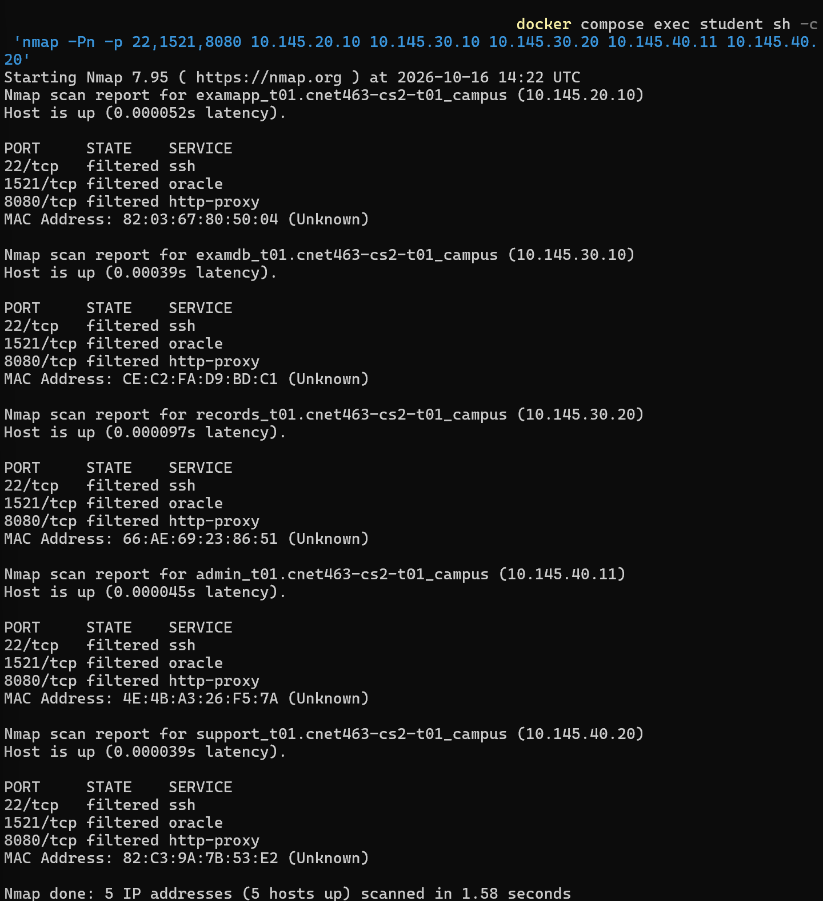
  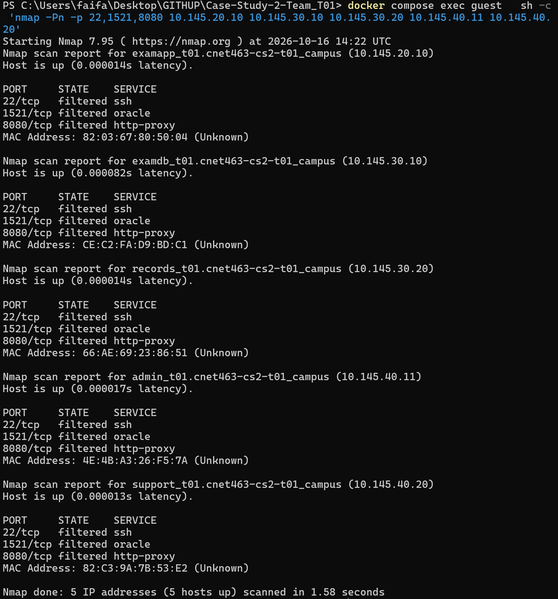
  <br>
  <em>Figures B7 & B9: Post-fix verification showing silent drop (filtered) across all unauthorized targets.</em>
</p>

#### Packet Capture Analysis (`tcpdump`)
To demonstrate that packets are silently discarded at the kernel packet filter rather than rejected, `tcpdump` was executed on `server-db` during scan activity:

```bash
docker compose exec -d examdb sh -c "timeout 10 tcpdump -ni eth0 -l 'tcp port 1521' > /tmp/c2.txt 2>&1"
```

<p align="center">
  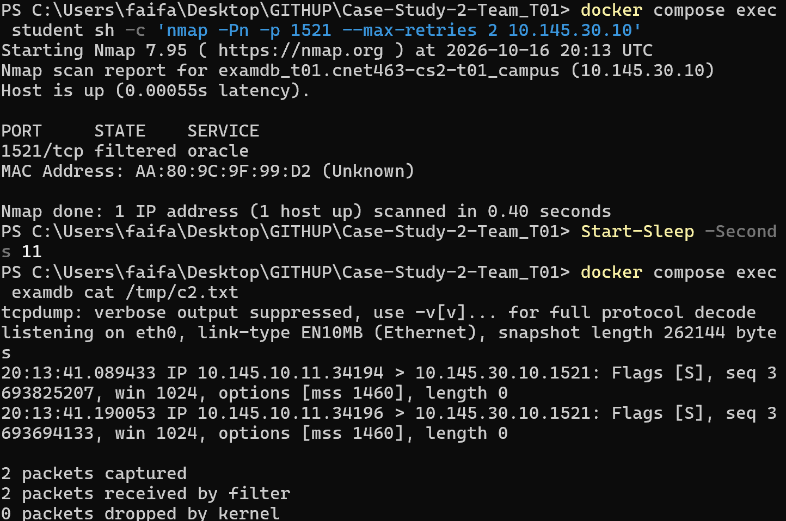
  <br>
  <em>Figure B9a: tcpdump on examdb — TCP SYN packets from student (10.145.10.11) receive zero response (silent drop).</em>
</p>

Conversely, legitimate requests originating from `examapp` (`10.145.20.10`) are promptly acknowledged with `SYN-ACK`:

<p align="center">
  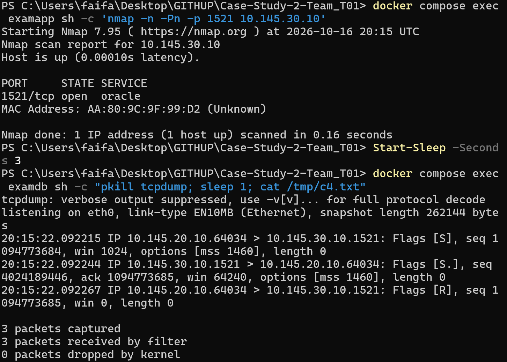
  <br>
  <em>Figure B9c: Authorized TCP handshake between examapp and examdb.</em>
</p>

### End-to-End Operational Validation
Legitimate student traffic routed through the PEP interface retains full operational functionality:

```bash
TOKEN=$(curl -s "http://10.145.50.11:8081/token?user=sara&role=student&device=managed")
curl -v --cacert /lab/pki/out/ca.crt --resolve exam.engineering.t01.uni.lab:10443:10.145.50.10 \
     -H "Authorization: Bearer $TOKEN" https://exam.engineering.t01.uni.lab:10443/exam
```

<p align="center">
  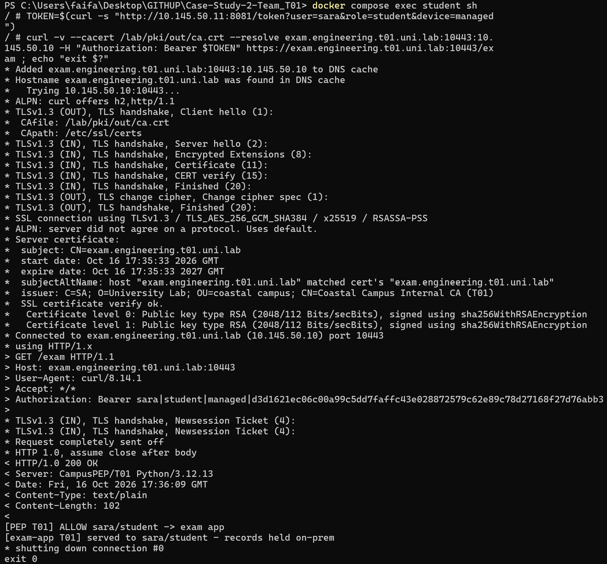
  <br>
  <em>Figure B11: Successful TLS handshake and HTTP/1.0 200 OK via PEP gateway post-segmentation.</em>
</p>

### Verified Campus Communication Matrix

| Source Zone / Host | Destination Host | Port / Protocol | Intended Policy | Identity / Device Requirement | Verification Evidence |
| :--- | :--- | :---: | :--- | :--- | :--- |
| `student` | `examapp` (via PEP) | `10443/tcp` (HTTPS) | **ALLOW** | Valid IdP Bearer token, Managed posture | HTTP 200 OK, exit code 0 ([Fig. B11](docs/images/fig_b11_curl_pep_success.png)) |
| `student` | `server-db` | `1521/tcp` | **DENY** | None (Direct access prohibited) | All ports `filtered` ([Fig. B7](docs/images/fig_b7_student_scan_after_fix.png)) |
| `examapp` | `server-db` | `1521/tcp` | **ALLOW** | Workload IP binding (`10.145.20.10`) | Port `1521 open` ([Fig. B10](docs/images/fig_b10_examapp_legitimate_scan.png)) |
| `examapp` | `server-records` | `8080/tcp` | **ALLOW** | Workload IP binding (`10.145.20.10`) | Port `8080 open` ([Fig. B10](docs/images/fig_b10_examapp_legitimate_scan.png)) |
| `guest` | *Any Internal Host* | *Any* | **DENY** | Untrusted external | All ports `filtered` ([Fig. B9](docs/images/fig_b9_guest_scan_after_fix.png)) |
| `vendor` | `server-support` | `22/tcp` (SSH) | **ALLOW** | WireGuard peer key + scoped IP | Port `22 open` ([Fig. D6](docs/images/fig_d6_vendor_scan_after_part1.png)) |
| `vendor` | `admin` (Jump Box) | `22/tcp` (SSH) | **DENY** | Non-administrative entity | Port `22 filtered`, SSH timeout ([Fig. D7](docs/images/fig_d7_vendor_ssh_test.png)) |
| `server-support` | `admin` (Jump Box) | `22/tcp` (SSH) | **ALLOW** | Admin zone member (`10.145.40.0/24`) | Port `22 open` ([Fig. B12](docs/images/fig_b12_support_to_admin_ssh_allowed.png)) |

---

## 6. Part C: Policy Enforcement Point (PEP) Hardening
**Assigned to:** Abdullah Abdali


1. Scope and lab values
All user traffic to the exam service passes through the Policy Enforcement Point (PEP, edge/pep.py). The PEP must make a Zero Trust decision on every request using the token issued by the Identity Provider (IdP), and must never trust the client's own claims or its network location. Our task was to test the PEP's policy, confirm which switches are set wrong, fix them, and prove the fix with before/after evidence.
Item	Team T01 value (from TEAM_INFO.txt)
Test host	student – 10.145.10.11 (User zone)
PEP	10.145.50.10, HTTPS port 10443
Exam service name	exam.engineering.t01.uni.lab
Identity Provider	http://10.145.50.11:8081/token
File edited	edge/pep.py (allowed file), then: docker compose restart pep
Tools used	curl (HTTP requests), openssl s_client (TLS test), docker compose, text editor
Note: curl was run with -k because the PEP's certificate is currently invalid (CN=staff.engineering.t01.uni.lab and expired 1 Feb 2024, visible in Figure 7). That certificate problem belongs to Part E; -k does not affect any access decision tested here.
2. Step 5 – Legitimate request (baseline)
A token was requested from the IdP for user sara, role student, device managed, then presented to the PEP as a Bearer token.
```bash
TOKEN=$(curl -s "http://10.145.50.11:8081/token?user=sara&role=student&device=managed")
```
```bash
curl -sk --resolve exam.engineering.t01.uni.lab:10443:10.145.50.10 -H "Authorization: Bearer $TOKEN" -w "\nHTTP_CODE=%{http_code}\n" https://exam.engineering.t01.uni.lab:10443/exam
```

Figure 1 – Legitimate request (sara / student / managed) → HTTP 200 ALLOW
Result: the token has the form user|role|device|signature. The PEP accepted it and forwarded the request to the exam app (HTTP 200). This is the reference request; every attack below changes exactly one element of it.
3. Step 6 – Probing the policy (BEFORE fix)
Attack 1 – Forged identity headers, no token
Reading edge/pep.py shows that the only client headers the PEP could believe are X-User, X-Role and X-Device (used only if TRUST_CLIENT_HEADERS is True). All three were sent without any token.

Figure 2 – Attack 1: forged X-User/X-Role/X-Device headers, no token → HTTP 401 DENY
Result: 401 "no valid IdP token". The PEP does not trust client-supplied identity. Already enforced – no weakness.
Attack 2 – Valid token with device posture "unmanaged"

Figure 3 – Attack 2 (BEFORE): token with device=unmanaged → HTTP 200 ALLOW
Result: 200 ALLOW. The PEP admitted a device that is not managed. Weakness C1 confirmed.
Attack 3 – Administrative paths through the student PEP

Figure 4 – Attack 3 (BEFORE): student token on /admin → HTTP 200 ALLOW

Figure 5 – Attack 3 (BEFORE): student token on /metrics → HTTP 200 ALLOW
Result: both administrative paths were forwarded for a student token. Weakness C2 confirmed.
Attack 4 – Deprecated TLS version
```bash
openssl s_client -connect 10.145.50.10:10443 -tls1 -cipher 'DEFAULT:@SECLEVEL=0' </dev/null
```

Figure 6 – Attack 4: TLS 1.0 handshake → "alert protocol version", Cipher is (NONE)
Result: the server refused TLS 1.0 ("tlsv1 alert protocol version", "Cipher is (NONE)"). The line "Protocol : TLSv1" only shows what our client attempted, and "Verification: OK" is meaningless here because no certificate was received. Already enforced – no weakness.
For comparison, a TLS 1.2 handshake was accepted:
```bash
openssl s_client -connect 10.145.50.10:10443 -tls1_2 </dev/null
```

Figure 7 – TLS 1.2 comparison (part 1): certificate CN=staff.engineering.t01.uni.lab, expired (Part E issue)

Figure 8 – TLS 1.2 comparison (part 2): "New, TLSv1.2, Cipher is ECDHE-RSA-AES256-GCM-SHA384" – accepted
Summary of probes
Probe	Expected	Observed (before fix)	Verdict
Forged headers, no token	401	401 DENY	Enforced
Token with device=unmanaged	Deny / challenge	200 ALLOW	Weakness C1
/admin and /metrics with student token	Not reachable	200 ALLOW	Weakness C2
TLS 1.0	Refused	alert protocol version	Enforced
4. Root cause in edge/pep.py

Figure 9 – edge/pep.py policy switches BEFORE the fix
Switch	Value found	Matching test	Assessment
TLS_MIN_VERSION	TLSv1_2	Attack 4 refused	Correct
TLS_CIPHERS	"DEFAULT"	TLS 1.2 strong cipher negotiated	No evidence of weakness
TRUST_CLIENT_HEADERS	False	Attack 1 → 401	Correct
REQUIRE_DEVICE_POSTURE	False	Attack 2 → 200	Wrong – must be True
EXPOSE_ADMIN_PATHS	True	Attack 3 → 200	Wrong – must be False
The tool results and the code agree: exactly two switches were wrong. The three correct switches were left unchanged, because changing a setting that tests show to be correct adds risk without benefit.
5. Step 7 – Fix
Two lines were changed in edge/pep.py, then the PEP was restarted so it reloaded the file:
```python
REQUIRE_DEVICE_POSTURE = True    # was False
EXPOSE_ADMIN_PATHS     = False   # was True
```
```bash
docker compose restart pep
```

Figure 10 – edge/pep.py policy switches AFTER the fix (REQUIRE_DEVICE_POSTURE = True, EXPOSE_ADMIN_PATHS = False)
6. Verification (AFTER fix)
New tokens were requested (TOKEN for managed, TOKEN_U for unmanaged) and the same commands were repeated.

Figure 11 – Attack 2 (AFTER): device=unmanaged → HTTP 403 "device posture 'unmanaged' not permitted"

Figure 12 – Attack 3 (AFTER): /admin → HTTP 404 "path not available through student-facing PEP"

Figure 13 – Attack 3 (AFTER): /metrics → HTTP 404

Figure 14 – Legitimate request (AFTER): sara / student / managed on /exam → HTTP 200 ALLOW
Both weaknesses are closed, and the legitimate request still succeeds, so the fix did not break permitted access.
7. Weakness explanations
C1 – Device posture not enforced
Problem: REQUIRE_DEVICE_POSTURE = False, so a validly signed token with device=unmanaged reached the exam (200, Figure 3).
Why dangerous: management requires that access depend on verified identity and device posture. Identity alone is not enough: an unmanaged device may be unpatched or compromised and could leak exam content or a session.
Fix: REQUIRE_DEVICE_POSTURE = True.
Proof: unmanaged now gets 403 (Figure 11); managed still gets 200 (Figure 14).
C2 – Administrative paths exposed through the student PEP
Problem: EXPOSE_ADMIN_PATHS = True, so /admin and /metrics were forwarded for a student token (200, Figures 4–5).
Why dangerous: it breaks least privilege and the requirement that privileged access be reachable only from the admin path. It also widens the attack surface of the student-facing entry point.
Fix: EXPOSE_ADMIN_PATHS = False.
Proof: both paths now return 404 (Figures 12–13); /exam still returns 200 (Figure 14).
8. Access conditions (tested)
Subject / role	Device	Resource	Context	Decision	Evidence (curl / openssl)
sara / student	managed	/exam	Valid IdP token	Allow	200 ALLOW (Fig. 1, Fig. 14)
No identity (forged X-User/X-Role: admin)	claimed managed	/exam	No token	Deny	401 no valid IdP token (Fig. 2)
sara / student	unmanaged	/exam	Valid IdP token	Deny	Before: 200 (Fig. 3); After: 403 (Fig. 11)
sara / student	managed	/admin	Student token	Deny	Before: 200 (Fig. 4); After: 404 (Fig. 12)
sara / student	managed	/metrics	Student token	Deny	Before: 200 (Fig. 5); After: 404 (Fig. 13)
sara / student	managed	/ADMIN	Case-variant path	Deny	Before: 200 (Fig. 15); After: 404 (Fig. 18)
Any client	—	PEP TLS	TLS 1.0	Deny	alert protocol version (Fig. 6)
Any client	—	PEP TLS	TLS 1.2	Allow	ECDHE-RSA-AES256-GCM-SHA384 (Fig. 8)
9. Why these fixes, and alternatives considered
Weakness	Fix applied	Alternative	Why we chose the applied fix
C1 Device posture	Deny unmanaged devices (403)	Challenge: redirect to device remediation or step-up verification	The assignment accepts deny or challenge. Deny uses the existing switch with no new code and gives clear evidence. Challenge needs device-management infrastructure. Trade-off: students on unmanaged personal devices are blocked, so the university must provide managed devices or an enrolment process.
C2 Admin paths	Block /admin and /metrics at the student PEP (404)	Allow these paths only for tokens with role=admin	Admins already have a dedicated path (admin zone, SSH to the jump host). Exposing admin functions on the student entry point, even only for admins, enlarges the attack surface.
10. Additional finding – case-sensitive path check (beyond required tests)
The path check used self.path.startswith(("/admin", "/metrics")), which is case-sensitive. We tested an upper-case variant after fixing C2.

Figure 15 – Additional (BEFORE): /ADMIN with student token → HTTP 200 ALLOW (bypass)

Figure 16 – Path check in edge/pep.py BEFORE the change

Figure 17 – Path check in edge/pep.py AFTER the change (.lower() added)

Figure 18 – Additional (AFTER): /ADMIN → HTTP 404 DENY

Figure 19 – Legitimate request after the .lower() change: /exam → HTTP 200 ALLOW
Fix: the path is converted to lower case before comparison, so /ADMIN, /Admin and /admin are all treated the same. After restarting the PEP, /ADMIN is denied (Figure 18) and the legitimate /exam request still succeeds (Figure 19).
11. Additional finding – URL-encoded path bypass (beyond required tests)
After the .lower() change, the path check still compared the raw, percent-encoded path. %61 is the URL encoding of the letter "a", so /%61dmin did not match /admin and passed the check, while the exam app decoded it to /admin. We tested this variant with curl --path-as-is so that curl sent the path unchanged.

Figure 20 – Additional (BEFORE): /%61dmin with student token → HTTP 200 ALLOW (bypass)

Figure 21 – Imports in edge/pep.py BEFORE the change

Figure 22 – Imports in edge/pep.py AFTER the change (urllib.parse added)

Figure 23 – Path check in edge/pep.py AFTER the change (urllib.parse.unquote() added)

Figure 24 – Additional (AFTER): /%61dmin → HTTP 404 DENY

Figure 25 – Legitimate request after the unquote() change: /exam → HTTP 200 ALLOW
Fix: the path is URL-decoded with urllib.parse.unquote() and then converted to lower case before comparison, so /%61dmin, /ADMIN and /admin are all treated the same. After restarting the PEP, /%61dmin is denied (Figure 24) and the legitimate /exam request still succeeds (Figure 25).
12. Residual risks
R1 – IdP issues tokens without authentication (tested)

Figure 26 – Additional: IdP issued a signed token for hacker / admin / managed on request
The IdP returned a validly signed token for user "hacker" with role admin and device managed, with no password or any other check. The PEP correctly verifies the signature, but it cannot know that the IdP never verified the user, role or device. Consequence: the device-posture control fixed in C1 can be bypassed by simply requesting device=managed. The IdP is not among the files we may modify, so this is documented, not fixed.
Recommendation: the IdP must authenticate users (password + MFA), take roles from a directory rather than from the request, obtain device posture from a device-management (MDM) system, and issue short-lived tokens.
Observed by code review (not tested)
R2 – Hard-coded secret: SHARED_SECRET is written in edge/pep.py. Anyone who can read the file can mint valid tokens. It should be stored in a secrets manager and rotated.
R3 – No token expiry: the token format user|role|device|signature has no timestamp, so a stolen token stays valid indefinitely.
R4 – Unencrypted PEP-to-app hop: UPSTREAM is http://10.145.20.10:80. The exam app relies on host-firewall segmentation (Part B) so that only the PEP can reach it.
13. Zero Trust link
This part applies the Zero Trust principle "never trust, always verify": being on the campus network gives no access. Every request is evaluated on identity (signed IdP token), device posture and requested resource, at the PEP, which is the policy enforcement component described in NIST SP 800-207. The result of the PEP's decision is the same whatever network location the request comes from

## 7. Part D: Secure Remote Connectivity & WireGuard Scoping
**Assigned to:** Abdulaziz Difallah Asiri

### Inspection of Vendor Tunnel Scope (Q8)
Inspection of `vendor/wg0.conf` revealed an egregious network-level VPN misconfiguration:

```ini
[Peer]
# Campus support gateway
PublicKey = <campus-support-public-key>
Endpoint = 10.145.40.20:51820
AllowedIPs = 10.145.0.0/16
PersistentKeepalive = 25
```

<p align="center">
  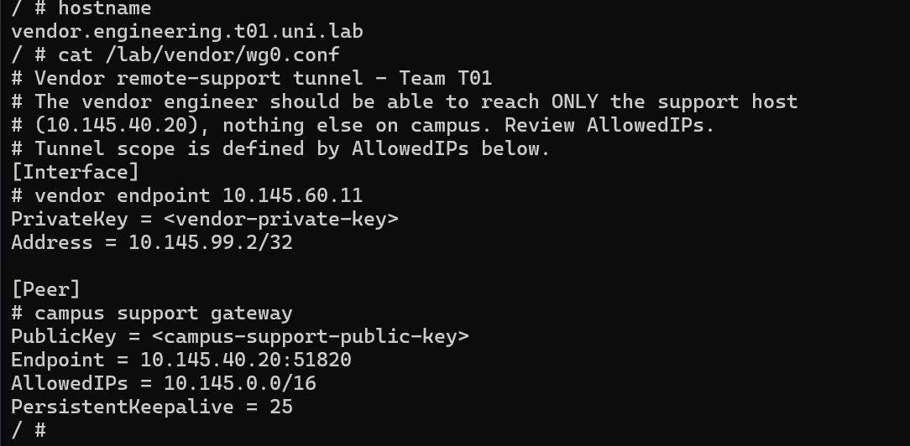
  <br>
  <em>Figure D1: Overly broad AllowedIPs (10.145.0.0/16) in vendor profile.</em>
</p>

Because WireGuard enforces cryptokey routing based on `AllowedIPs`, this configuration routed all 65,536 campus addresses across every subnet through the tunnel interface.

### Vendor Reachability Prior to Remediation (Q9)
An nmap scan from `vendor` (`10.145.60.11`) confirmed full lateral connectivity:

<p align="center">
  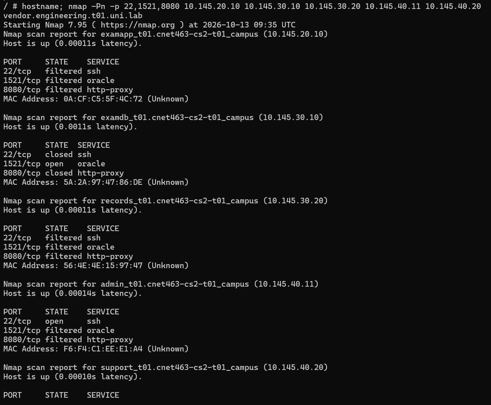
  <br>
  <em>Figure D2: Vendor accesses support host (22/tcp), database (1521/tcp), and admin jump host (22/tcp).</em>
</p>

### Root Cause & Double-Layered Trust
The vendor's excessive reach resulted from two layers of trust:
1. **Client Tunnel Profile:** Broad `AllowedIPs = 10.145.0.0/16`.
2. **Host-Level Firewall Rules:**
   - `firewall/admin.nft`: Explicit rule `ip saddr 10.145.60.11 tcp dport 22 accept`.
   - `firewall/server-db.nft`: Explicit rule `ip saddr 10.145.60.11 accept`.

<p align="center">
  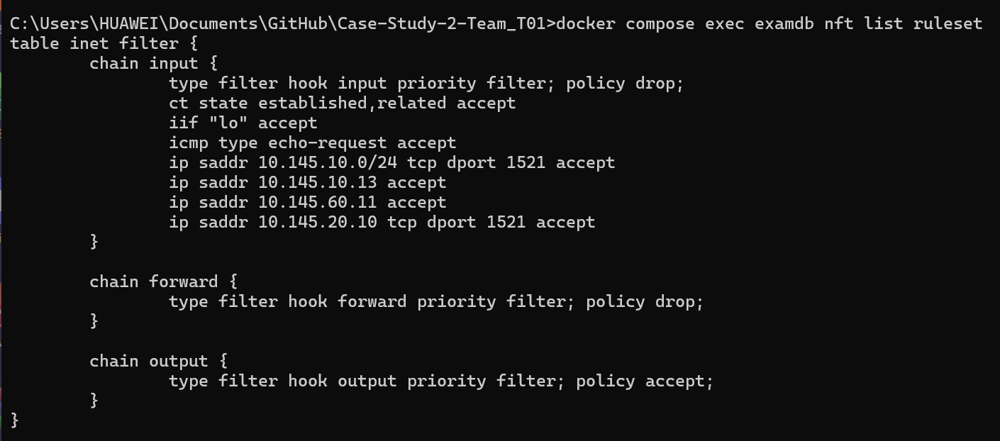<br>
  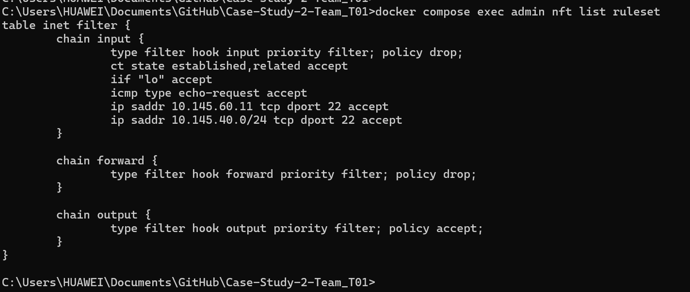
  <br>
  <em>Figure D3: Active firewall rules granting unconditional access to the vendor.</em>
</p>

### Remediation & Scoping (Q10)
We enforced least-privilege scoping across both the tunnel configuration and target host firewalls:
1. **WireGuard Profile (`vendor/wg0.conf`):** Restructured `AllowedIPs = 10.145.40.20/32` (restricted solely to the support host).
2. **Admin Firewall (`firewall/admin.nft`):** Removed `ip saddr 10.145.60.11 tcp dport 22 accept`.
3. **Database Firewall (`firewall/server-db.nft`):** Removed `ip saddr 10.145.60.11 accept`.

<p align="center">
  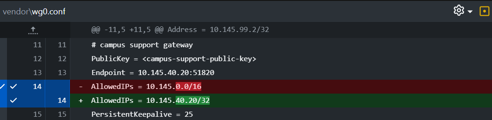<br>
  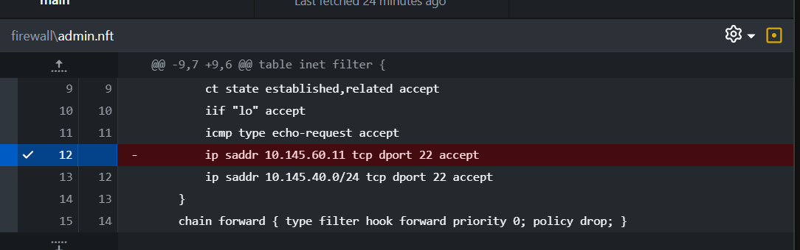<br>
  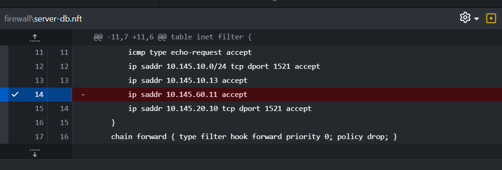
  <br>
  <em>Figure D4: Diffs for vendor tunnel profile and affected host firewalls.</em>
</p>

### Post-Remediation Verification
Scans and automated non-interactive SSH connections (`BatchMode=yes -o ConnectTimeout=5`) verified that the vendor is isolated to `server-support`:

```bash
docker compose exec vendor sh -c 'ssh -o ConnectTimeout=5 -o BatchMode=yes test@10.145.40.11; echo exit $?'
docker compose exec vendor sh -c 'ssh -o ConnectTimeout=5 -o BatchMode=yes test@10.145.40.20; echo exit $?'
```

<p align="center">
  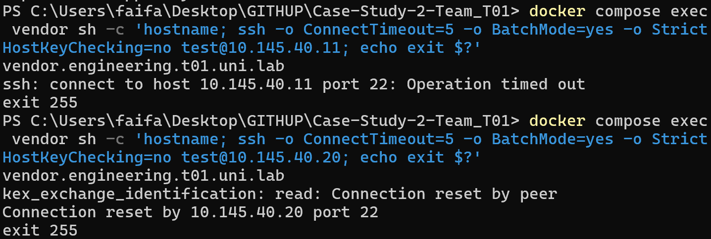
  <br>
  <em>Figure D7: SSH to admin (10.145.40.11) times out (packet drop), while SSH to support (10.145.40.20) reaches the SSH daemon.</em>
</p>

<p align="center">
  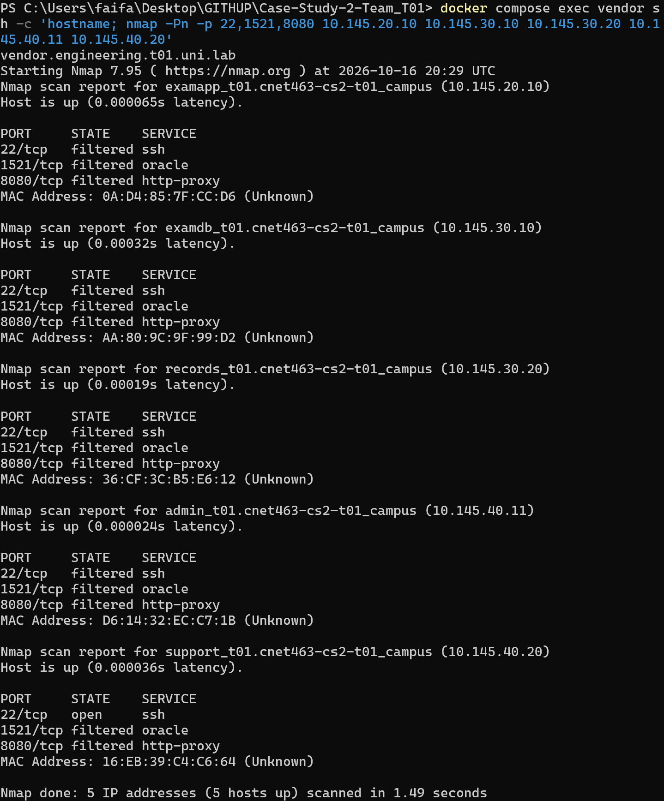
  <br>
  <em>Figure D6b: Post-fix vendor scan confirming all non-support targets are filtered.</em>
</p>

### Architectural Evaluation: VPN vs. ZTNA (Q11)

| Evaluation Criterion | Traditional VPN (WireGuard / IPSec) | Zero Trust Network Access (ZTNA) | Recommended for Privileged Users? |
| :--- | :--- | :--- | :---: |
| **Access Scope** | Network-level (CIDR subnet / broad routing). A compromise exposes adjacent hosts. | Application-level micro-tunnels. Users only see explicitly authorized endpoints. | **ZTNA** |
| **Identity Context** | Evaluated once during tunnel initiation. Subsequent packets trusted via IP. | Evaluated continuously per request using cryptographically signed IdP claims. | **ZTNA** |
| **Device Posture** | Generally uninspected or checked only during login. | Continuously validated (OS patch level, EDR status, disk encryption). | **ZTNA** |
| **Operational Complexity** | Low. Standard kernel module and configuration files. | Medium/High. Requires PEP brokers, IdP integrations, and policy engines. | **VPN** (simplicity) |
| **Blast Radius & Monitoring**| Large blast radius. Logs record tunnel session duration, not granular HTTP/API verbs. | Minimal blast radius. Logs capture exact user IDs, endpoints, and transaction payloads. | **ZTNA** |

---

## 8. Part E: TLS, Public Key Infrastructure (PKI) & Trust Lifecycle
**Assigned to:** Abdulaziz Difallah Asiri

### Live Certificate Inspection & Flaw Identification (Q12, Q13)
We analyzed the TLS certificate presented by the PEP on port `10443` using OpenSSL and cURL:

```bash
docker compose exec student openssl s_client -connect 10.145.50.10:10443 -servername exam.engineering.t01.uni.lab -CAfile /lab/pki/out/ca.crt -showcerts </dev/null
```

<p align="center">
  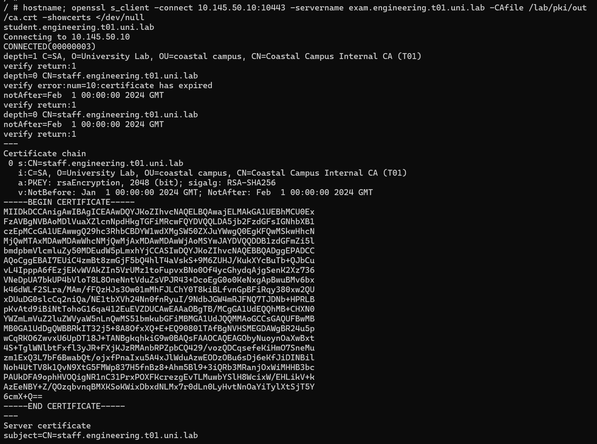
  <br>
  <em>Figure E1: OpenSSL probe reveals "certificate has expired" (Verify return code: 10).</em>
</p>

```bash
docker compose exec student openssl x509 -in /lab/pki/out/exam.crt -noout -subject -issuer -dates -ext subjectAltName
```

<p align="center">
  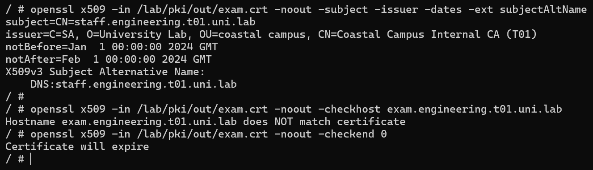
  <br>
  <em>Figure E2: x509 inspection proves CN/SAN mismatch and hardcoded expired dates.</em>
</p>

```bash
# cURL connection without '-k' flag
docker compose exec student curl -v --cacert /lab/pki/out/ca.crt --resolve exam.engineering.t01.uni.lab:10443:10.145.50.10 https://exam.engineering.t01.uni.lab:10443/exam
```

<p align="center">
  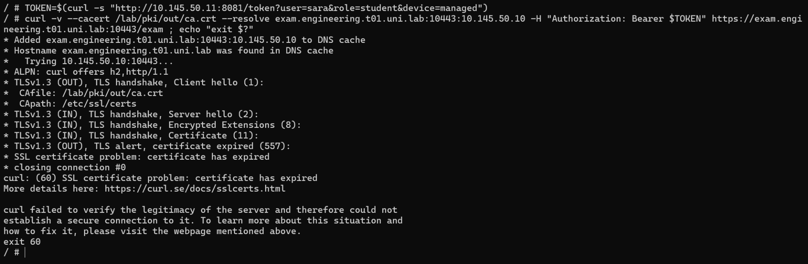
  <br>
  <em>Figure E3: cURL fails with exit code 60: "SSL certificate problem: certificate has expired".</em>
</p>

### Root Cause Analysis in Certificate Generation Script
Inspection of `pki/make_certs.sh` revealed two critical errors:
1. **Hardcoded Past Dates:** `-startdate 20240101000000Z -enddate 20240201000000Z` caused every certificate generated to be expired on creation.
2. **Domain Identity Mismatch:** The Common Name and Subject Alternative Name were assigned to `staff.engineering.t01.uni.lab` instead of the exam service FQDN `exam.engineering.t01.uni.lab`.

### Applied Remediation (Q14)
We corrected `pki/make_certs.sh`:
- Updated CN and SAN to `exam.engineering.t01.uni.lab`.
- Replaced fixed dates with `-days 365` for continuous real-time validity.

<p align="center">
  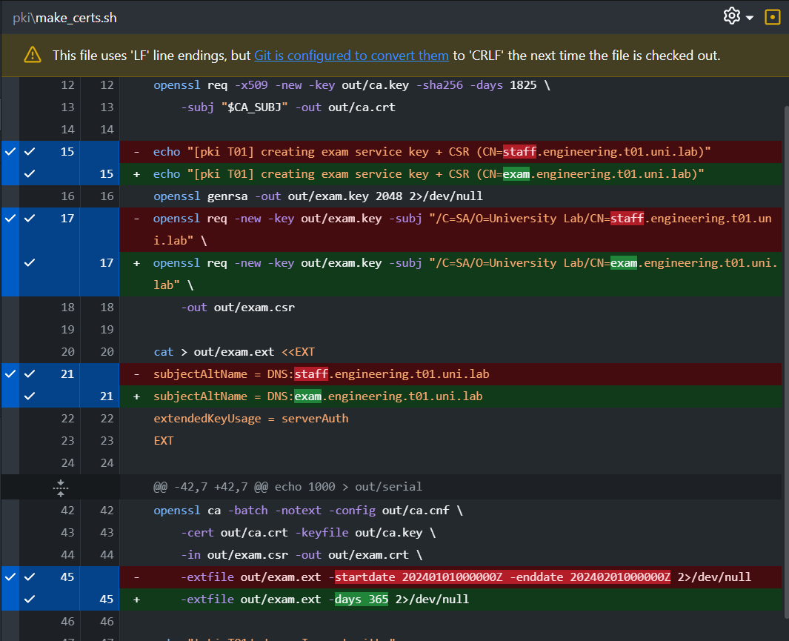
  <br>
  <em>Figure E4: Git diff in pki/make_certs.sh correcting SAN and validity duration.</em>
</p>

```bash
# Regenerate certificates and restart PEP gateway
docker compose run --rm pki
docker compose restart pep
```

<p align="center">
  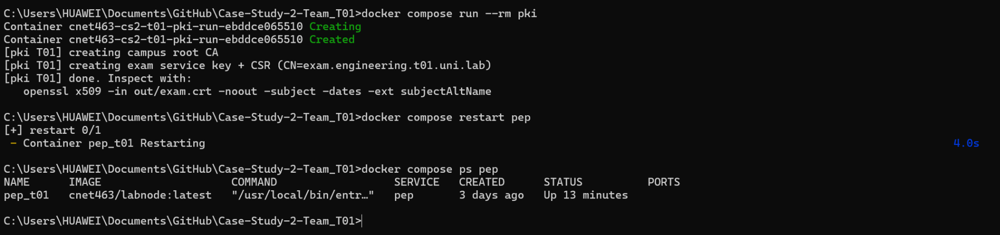
  <br>
  <em>Figure E5: Clean PKI issuance pipeline run and PEP restart.</em>
</p>

### Post-Remediation Verification
Re-testing confirmed clean certificate chain validation:
- `openssl s_client` -> `Verify return code: 0 (ok)`.
- `openssl x509` -> Hostname matches certificate, valid for 365 days.
- `curl` (without `-k`) -> `HTTP/1.0 200 OK` (exit code `0`).

<p align="center">
  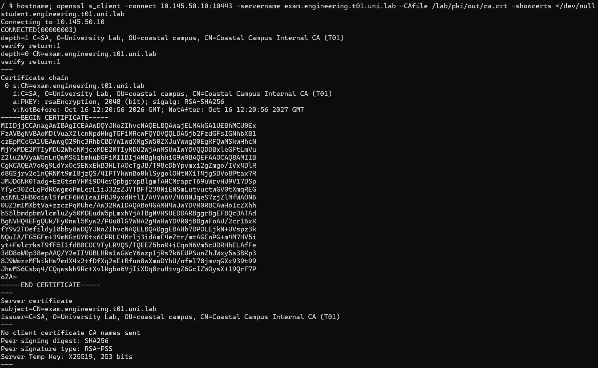
  <br>
  <em>Figure E6: OpenSSL verification successful (Return Code 0 OK).</em>
</p>

<p align="center">
  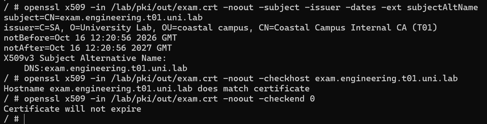
  <br>
  <em>Figure E7: Hostname matches certificate and validity confirmed.</em>
</p>

<p align="center">
  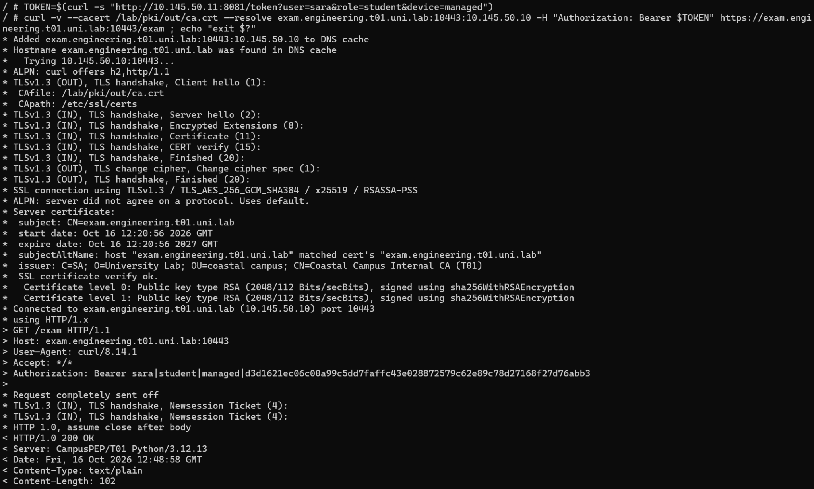
  <br>
  <em>Figure E8: Seamless TLS handshake and verified application data retrieval.</em>
</p>

### Cryptographic Lifecycle & Key Material Exposure (Q15)
During audit procedures, we uncovered a significant key-management risk:
The entire PKI output folder (`pki/out/`), including `ca.key` (Root CA private key) and `exam.key`, was mounted into every lab container. Any user gaining root in a container could read `ca.key` and forge valid SSL certificates for any university domain!

<p align="center">
  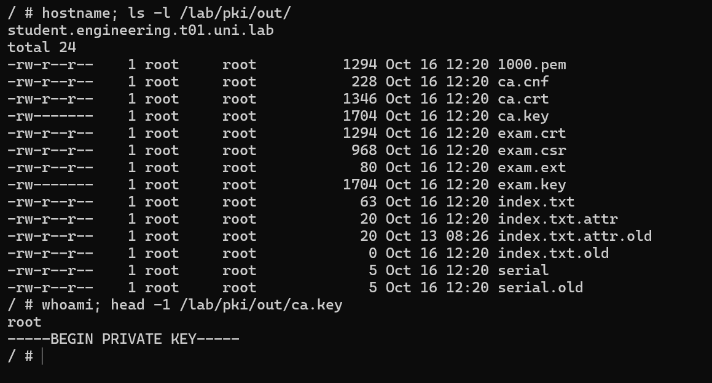
  <br>
  <em>Figure E9: CA root private key readable from student container.</em>
</p>

**Production Recommendations:**
1. Store Root CA keys offline or in a Hardware Security Module (HSM).
2. Distribute only `ca.crt` to client workstations.
3. Deploy automated certificate expiry monitoring alerting 30 days prior (`openssl x509 -checkend 2592000`).

---

## 9. Part F: Cloud/Hybrid Controls & Shared Responsibility Framework
**Assigned to:** Khalid Alfaifi

### Hybrid Connectivity & Egress Restrictions
In our hybrid architecture, `examapp` (`10.145.20.10`) represents the cloud component connecting back to the on-premises records service (`server-records`, `10.145.30.20:8080`).

We conducted full port scans from `examapp` targeting `server-records`:

```bash
docker compose exec examapp nmap -Pn -p- --min-rate 3000 --max-retries 1 10.145.30.20
```

<p align="center">
  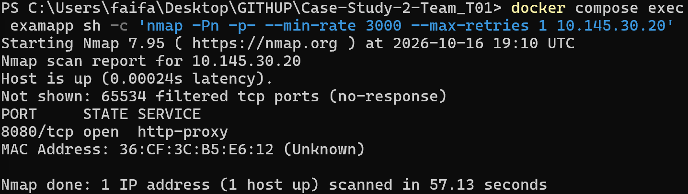
  <br>
  <em>Figure F1: All 65,534 non-essential ports filtered; only 8080/tcp open.</em>
</p>

Legitimate egress requests succeed, while unauthorized user access from `student` times out:

<table align="center">
  <tr>
    <td align="center"><b>Examapp to Records (HTTP 200 OK)</b></td>
    <td align="center"><b>Student to Records (Connection Timeout)</b></td>
  </tr>
  <tr>
    <td>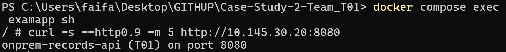</td>
    <td>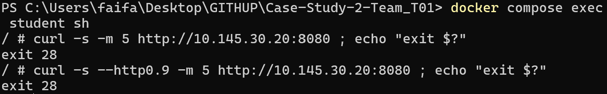</td>
  </tr>
  <tr>
    <td align="center"><em>Figure F2: Authorized hybrid transaction.</em></td>
    <td align="center"><em>Figure F3: Unauthorized direct student query blocked.</em></td>
  </tr>
</table>

### Cloud Shared Responsibility Matrix (AWS / Azure / GCP Equivalent)

| Security Control Area | Cloud Service Provider (CSP) Responsibility | University IT Security Responsibility | Lab Evidence & Findings |
| :--- | :--- | :--- | :--- |
| **Workload Identity** | Provides IAM roles, Instance Metadata Service, and Workload Identity Federation. | Configures least-privilege service roles; avoids reliance on static source IP addresses. | Records host currently filters by IP (`10.145.20.10`), not cryptographically authenticated service identity. |
| **Network Egress & Firewalls** | Secures hypervisor virtual networks, AWS Security Groups / VPC Route Tables. | Formulates egress firewall rules; limits outbound traffic strictly to approved ports (`8080`). | Port scanning proved strict filtering on `8080/tcp` ([Fig. F1](docs/images/fig_f1_examapp_to_records_nmap.png)). Guest allow-all rule eliminated. |
| **Cryptographic Secrets Management** | Provides hardware-backed KMS, Key Vaults, and automated rotation infrastructure. | Manages secret injection, prevents secrets in source repositories or client filesystems. | Plaintext hardcoded secret `b"idp-pep-shared-secret-T01"` discovered in `idp/app.py` ([Fig. F4](docs/images/fig_f4_hardcoded_secret_idp.png)). CA key exposed to students. |
| **API & Inter-Service Security** | Manages API Gateway infrastructure, edge DDoS mitigation, and WAF engines. | Defines API authentication tokens, mutual TLS (mTLS), and endpoint authorization checks. | Records API answers queries without requiring client certificates or authorization headers. |
| **Change Governance & CI/CD** | Protects the cloud management console, IAM APIs, and infrastructure auditing. | Reviews and signs Infrastructure as Code (IaC) and container images before deployment. | Flawed firewall rules were deployed without peer review or automated policy checks. |
| **Telemetry & Central Logging** | Provides VPC Flow Logs, CloudTrail / Activity Logs, and storage immutability. | Ingests flow logs into SIEM, configures real-time alerts on dropped packets and anomalies. | The PEP logs decisions (`ALLOW sara/student`), but host firewalls drop packets silently without centralized SIEM ingestion. |
| **Business Continuity & Backups**| Guarantees cloud hypervisor availability and physical multi-datacenter replication. | Maintains encrypted backups of academic databases and formulates hybrid failover plans. | Assumed university maintains point-in-time database recovery archives. |

<p align="center">
  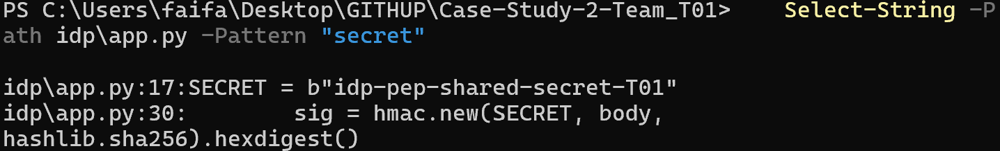
  <br>
  <em>Figure F4: Plaintext shared secret hardcoded in idp/app.py.</em>
</p>

---

## 10. Part G: CISA ZTMM v2.0 Maturity Rating & Management Memo
**Assigned to:** Khalid Al-Qanbar

### CISA Zero Trust Maturity Model (ZTMM v2.0) Rating

```
Traditional ──► Initial ──► Advanced ──► Optimal
```

Based strictly on empirical evidence gathered in Parts B through F, the university's post-remediation posture is rated as follows:

| ZTMM Pillar | Current Maturity Stage | Lab Evidence & Current Posture | Strategic Next Steps to Mature |
| :--- | :---: | :--- | :--- |
| **1. Identity** | **Initial** | Centralized IdP issues HMAC tokens evaluated by PEP ([Fig. B11](docs/images/fig_b11_curl_pep_success.png)). However, IdP lacks MFA, and vendor tunnel still relies on static IP address bindings. | Implement Phishing-Resistant MFA (FIDO2/WebAuthn), integrate campus Active Directory / OAuth2, and bind vendor sessions to individual named identities. |
| **2. Devices** | **Traditional** | PEP enforces `device=managed` ([Fig. C11](docs/images/fig_c11_pep_unmanaged_403_after.png)), but posture is merely an unverified request query parameter without hardware validation. | Deploy unified Endpoint Detection & Response (EDR) and MDM with cryptographic client posture certificates. |
| **3. Networks** | **Initial** | Host firewalls enforce default-drop policies ([Fig. B6](docs/images/fig_b6_nftables_active_rules_after_fix.png)), and WireGuard tunnel is scoped to a single host ([Fig. D6b](docs/images/fig_d6b_vendor_scan_all_after.png)). However, all containers share one physical bridge and rely on static IP rules. | Implement identity-aware micro-segmentation (e.g. Cilium / Envoy service mesh) and transition vendor access from VPN to ZTNA. |
| **4. Applications & Workloads** | **Initial** | Student access is mediated through a reverse-proxy PEP with verified TLS 1.3 ([Fig. E8](docs/images/fig_e8_curl_cert_verified_success_part1.png)). Protected routes (`/admin`) are restricted. Inter-service calls lack authentication. | Implement Mutual TLS (mTLS) with SPIFFE/SPIRE workload identities between `examapp`, `server-records`, and `server-db`. |
| **5. Data** | **Initial** | Database access is restricted exclusively to the exam app IP ([Fig. B10](docs/images/fig_b10_examapp_legitimate_scan.png)). However, database wire protocol is unencrypted, and root CA private key was exposed on client disks. | Enforce end-to-end TLS encryption on Oracle DB listener, migrate CA keys to a cloud HSM, and deploy Data Loss Prevention (DLP). |

---

### Executive Management Memo

> Summary version. The full one-page memo (business issue, main risk, evidence, two alternatives, recommendation, accountability and deadline, evidence of success, residual risk) is in the submitted report.

```text
MEMORANDUM

TO:       University IT Management & Chief Information Security Officer (CISO)
FROM:     Team T01 (CNET-463 Security Engineering Taskforce)
DATE:     October 17, 2026
SUBJECT:  Zero Trust Architectural Transformation: Hybrid Online Examination Infrastructure
```

#### 1. Business Context & Strategic Need
Jazan University is transitioning the Online Examination System to a hybrid topology to support scalable digital testing while keeping sensitive student records on premises. Under the legacy perimeter security model, trust was implicitly granted based on network location.

#### 2. Main Discovered Risks
Active scanning proved that an attacker compromising an untrusted student laptop, guest mobile device, or vendor technician account could bypass access controls entirely:
- Direct access to SQL port `1521` on the examination database.
- Direct access to REST port `8080` on academic records.
- Direct SSH access to the central administrative jump host.
- Exploitation of an expired, mismatched SSL certificate allowing Man-in-the-Middle (MitM) token harvesting.

#### 3. Strategic Alternatives Evaluated
- **Alternative 1 (Status Quo Maintenance):** Maintain network VPNs and static firewall rules.  
  *Pros:* Zero additional software licensing cost.  
  *Cons:* Trust remains address-based. Stolen vendor credentials still grant direct network access. High maintenance overhead.
- **Alternative 2 (Comprehensive Zero Trust Network Access - ZTNA):** Maintain corrected host firewalls as a defense-in-depth base layer while deploying application-level ZTNA with MFA and continuous device posture checks for vendors and administrators.  
  *Pros:* Minimal blast radius, cryptographically verifiable identity, granular per-request audit logging, elimination of lateral movement paths.  
  *Cons:* Requires IdP and access broker deployment.

#### 4. Final Recommendation & Implementation Roadmap
**Adopt Alternative 2.** Deploy ZTNA across high-risk privileged paths immediately, supported by the following milestones:
- **Phase 1 (Immediate / 30 Days):** Migrate root CA keys to an offline HSM, implement automated certificate expiration alerting (30-day thresholds), and enforce central firewall drop logging.
- **Phase 2 (90 Days):** Replace static WireGuard vendor access with an identity-brokered ZTNA gateway requiring MFA and session recording.
- **Phase 3 (180 Days):** Implement mutual TLS (mTLS) with SPIFFE/SPIRE for east-west service calls and integrate campus Active Directory with the IdP.

---

## 11. Quickstart: Deploying & Validating the Lab

### 1. Build and Initialize PKI Certificates
Generate root CA and service certificates with the corrected SAN and validity:

```bash
docker compose run --rm pki
```

### 2. Launch the Segmented Lab
Start all 11 isolated containers in detached mode:

```bash
docker compose up -d
```

### 3. Verify System Status
```bash
docker compose ps
```

### 4. Execute Verification Tests
Run automated security tests from the student workstation:

```bash
# Connect to student container
docker compose exec student sh

# 1. Verify database is blocked (filtered)
nmap -Pn -p 1521 10.145.30.10

# 2. Acquire valid token from IdP
TOKEN=$(curl -s "http://10.145.50.11:8081/token?user=sara&role=student&device=managed")

# 3. Test verified access to Exam Service
curl -v --cacert /lab/pki/out/ca.crt --resolve exam.engineering.t01.uni.lab:10443:10.145.50.10 \
     -H "Authorization: Bearer $TOKEN" https://exam.engineering.t01.uni.lab:10443/exam

# 4. Confirm unmanaged device rejection (HTTP 403)
TOKEN_U=$(curl -s "http://10.145.50.11:8081/token?user=sara&role=student&device=unmanaged")
curl -sk --resolve exam.engineering.t01.uni.lab:10443:10.145.50.10 \
     -H "Authorization: Bearer $TOKEN_U" https://exam.engineering.t01.uni.lab:10443/exam

# 5. Confirm admin path restriction (HTTP 404)
curl -sk --resolve exam.engineering.t01.uni.lab:10443:10.145.50.10 \
     -H "Authorization: Bearer $TOKEN" https://exam.engineering.t01.uni.lab:10443/admin
```

### 5. Tear Down the Environment
```bash
docker compose down -v
```

---

## 12. Academic References

1. **Rose, S., Borchert, O., Mitchell, S., & Connelly, S.** (2020). *Zero Trust Architecture*. NIST Special Publication 800-207. National Institute of Standards and Technology. https://doi.org/10.6028/NIST.SP.800-207
2. **Cybersecurity and Infrastructure Security Agency (CISA).** (2023). *Zero Trust Maturity Model (Version 2.0)*. CISA Cybersecurity Division.
3. **Barker, E.** (2020). *Recommendation for Key Management: Part 1 – General*. NIST SP 800-57 Part 1 Rev. 5. https://doi.org/10.6028/NIST.SP.800-57pt1r5
4. **Rescorla, E.** (2018). *The Transport Layer Security (TLS) Protocol Version 1.3*. RFC 8446. Internet Engineering Task Force.
5. **Moriarty, K., & Farrell, S.** (2021). *Deprecating TLS 1.0 and TLS 1.1*. RFC 8996. Internet Engineering Task Force.
6. **Cooper, D., Santesson, S., Farrell, S., Boeyen, S., Housley, R., & Polk, W.** (2008). *Internet X.509 Public Key Infrastructure Certificate and Certificate Revocation List (CRL) Profile*. RFC 5280.
7. **Scarfone, K., & Hoffman, P.** (2009). *Guidelines on Firewalls and Firewall Policy*. NIST SP 800-41 Rev. 1.
8. **Donenfeld, J. A.** (2017). *WireGuard: Next Generation Kernel Network Tunnel*. Proceedings of the Network and Distributed System Security Symposium (NDSS).
9. **Jubur, M.** (2026). *CNET-463 Case Study 2: Zero Trust Hybrid University Network, Hands-On Lab (Team T01)*. Department of Computer & Network Engineering, Jazan University.
10. **Amazon Web Services.** (2026). *AWS Shared Responsibility Model*. https://aws.amazon.com/compliance/shared-responsibility-model/

---
<p align="center">
  <b>Developed by Team T01 — Jazan University, 2026</b><br>
  <i>Lab kit designed and built by Dr. Mohammed Jubur (CNET-463).</i><br>
  <i>All security tests and packet captures conducted inside an isolated academic sandbox environment.</i>
</p>
